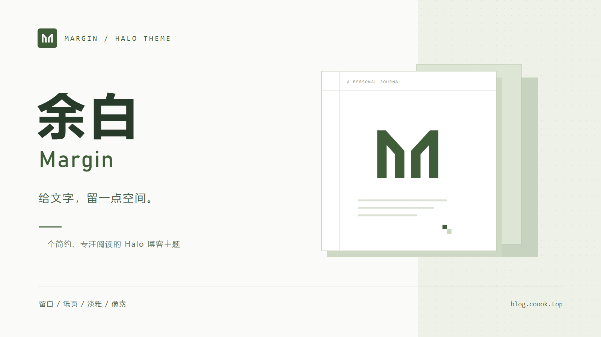
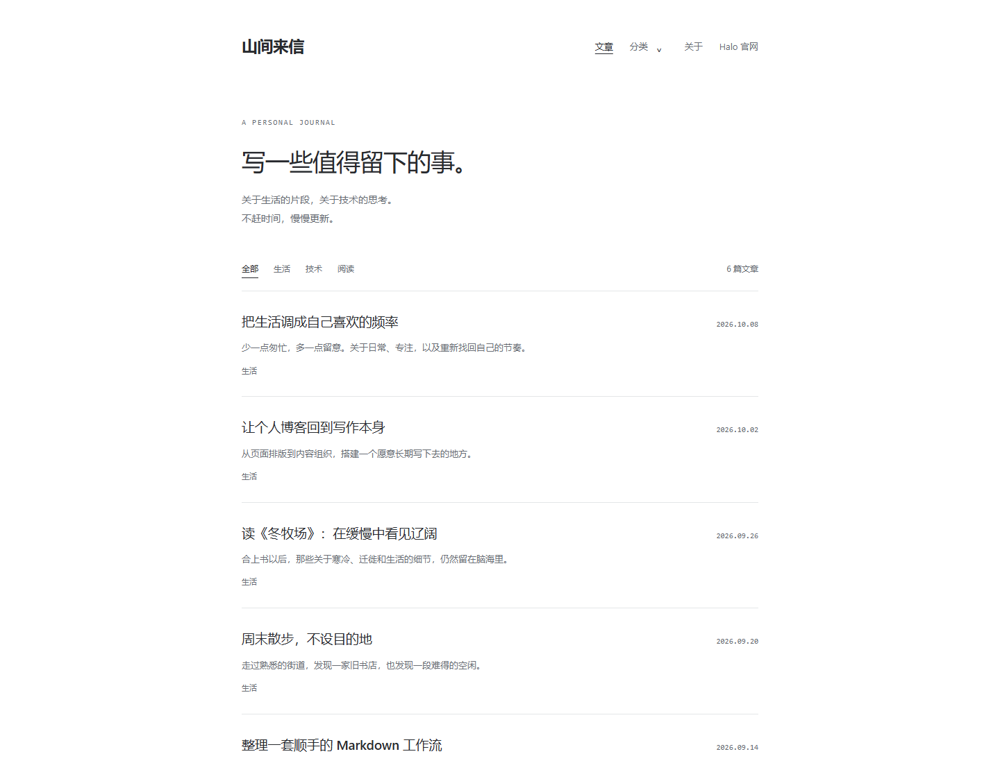
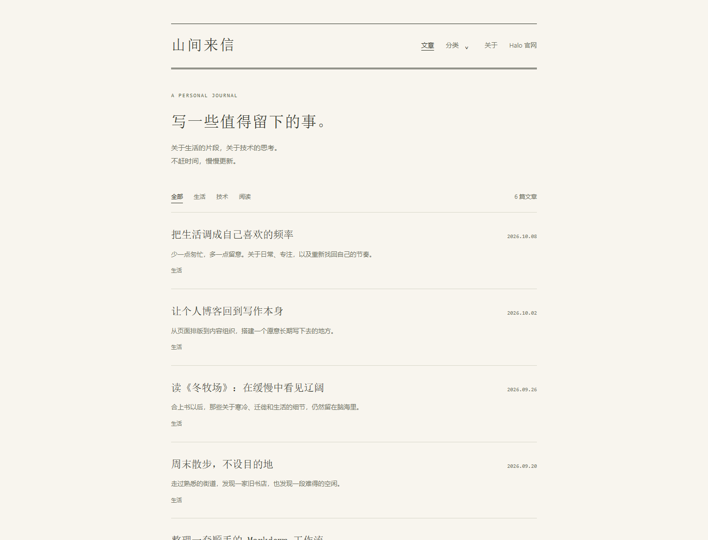
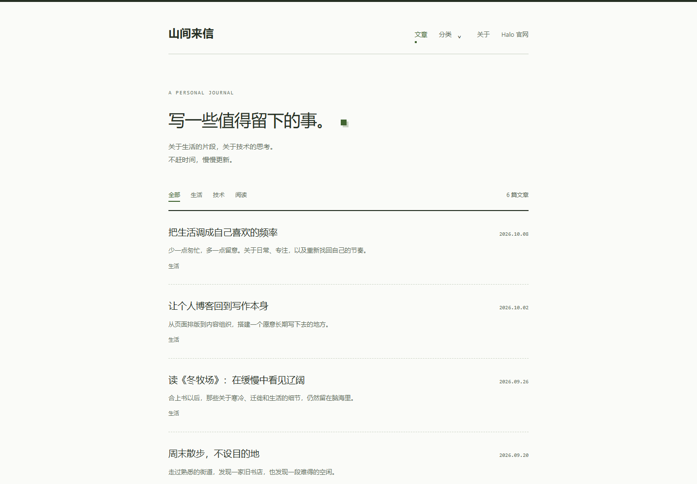
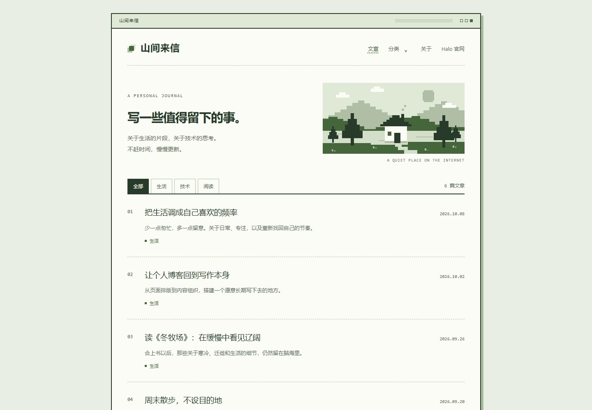

# 1. 简介

  

**余白 · Margin** 是一款简约、专注阅读的 Halo 博客主题，最低安装版本要求为 **Halo 2.0.0**。目前在 Halo 2.20.21 上进行过联调，较早版本尚未完整验证。

在线预览：[https://blog.coook.top/](https://blog.coook.top/)

提供四种视觉风格：

- **留白**：简洁黑白，清晰舒展。
- **纸页**：暖色背景，书刊式排版。
- **淡雅**：清浅苔绿，方块点缀与虚线分隔。
- **像素**：复古窗口、点阵字标与像素插画。

支持单／双列文章列表、明暗模式和手机适配，提供多级菜单、文章目录、图片放大与缩放等阅读功能。

# 2. 风格预览

以下为四种风格的浅色模式首页预览，使用相同的示例内容展示。

## 2.1. 留白

## 2.2. 纸页

## 2.3. 淡雅

## 2.4. 像素

# 3. 使用方式

1. 前往 [GitHub Releases](https://github.com/lzcer/halo-theme-margin/releases)，下载 `halo-theme-margin-<版本号>.zip`。
2. 在 Halo 后台进入「外观 → 主题」，上传 ZIP，启用「余白 · Margin」。
3. 打开主题设置，在「外观与布局」中选择视觉风格、文章列表布局和明暗模式，并按需开启或关闭摘要、分类 Tab。
4. 在「首页介绍」中设置介绍文字；在「文章阅读」中调整字号、摘要和目录位置，目录支持顶部、左侧或右侧，手机端自动放到顶部。
5. 在 Halo 系统设置中配置站点标题、Logo、描述和 favicon；在菜单管理中维护导航名称、链接、顺序和层级。主题默认使用主菜单，也可在主题设置的「导航菜单」中指定其他菜单。

更新主题时，从 Releases 下载新版主题 ZIP，在 Halo 后台对现有主题执行更新，完成后检查主题设置和页面效果。请使用 Release 附件中的主题 ZIP，不要使用 GitHub 自动生成的 **Source code** 压缩包。

如需显示评论，请安装并启用兼容的 Halo 评论插件，并开启对应文章的评论功能。

安装并启用 [plugin-map-marker](https://github.com/lzcer/plugin-map-marker) 后，主题会提供 `/maps` 足迹页面。原作者已删除原仓库，此链接为 fork 仓库地址。地点、分组和文章绑定由插件管理；地图供应商与 Public Token 在主题设置的「足迹地图」中配置。
